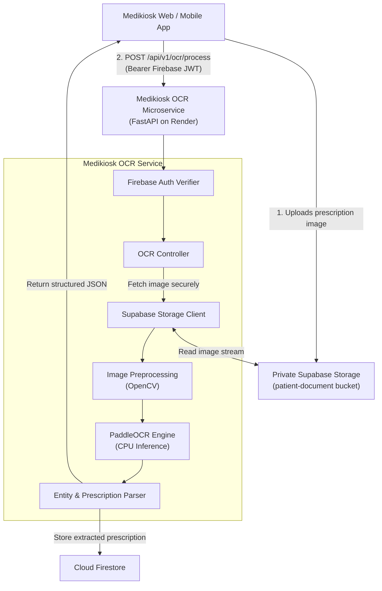

# Medikiosk OCR Microservice

An independent, Python-based OCR microservice for the Medikiosk healthcare platform, responsible for extracting and digitizing medical prescription information from patient-uploaded images.

> [!IMPORTANT]
> **Current Status: Phase 0 (Repository Foundation & Environment Setup)**  
> This repository currently provides the core FastAPI structure, environment definitions, container configuration, and health endpoints. OCR engines, image processing pipelines, Firebase authentication, and Supabase integration are **planned for upcoming phases** and are **not yet implemented**.

---

## 1. Project Overview

**Medikiosk OCR** is a specialized backend microservice within the Medikiosk digital healthcare ecosystem. Its primary objective is to receive prescription images uploaded by patients or clinic staff, extract textual data (medication names, dosages, frequencies, and doctor instructions) using Optical Character Recognition (OCR), and return structured medical data.

### Why a Separate Repository?

The main Medikiosk application is maintained in a separate repository by another developer. Medikiosk OCR is kept in this separate, dedicated repository for key architectural reasons:

1. **Independent Lifecycles & Versioning:** The OCR engine, computer vision libraries, and ML models evolve independently of the main web application and frontend.
2. **Resource & Scaling Requirements:** Heavy CPU/memory tasks like OCR image processing require dedicated resource allocation and horizontal scaling on platforms like Render without affecting the primary API or frontend.
3. **Dependency Isolation:** Machine learning frameworks (PaddlePaddle, PaddleOCR, OpenCV) bring substantial binary dependencies and strict C-extension requirements that should not pollute or complicate the main application's dependency tree.
4. **Separation of Ownership & Security Boundaries:** Isolating patient document processing reduces attack surface and permits strict least-privilege credential management.

---

## 2. Planned Technology Stack

| Layer | Component | Planned Version / Tool | Status |
| :--- | :--- | :--- | :--- |
| **API Framework** | FastAPI | `>= 0.115.0` | **Implemented (Phase 0)** |
| **ASGI Server** | Uvicorn | `>= 0.34.0` | **Implemented (Phase 0)** |
| **Configuration** | python-dotenv | `>= 1.0.1` | **Implemented (Phase 0)** |
| **Containerization** | Docker & Docker Compose | Docker 29+ / Compose 5+ | **Implemented (Phase 0)** |
| **Runtime Environment** | Python (CPU-targeted) | `3.11.x` (`python:3.11-slim`) | **Specified (Phase 0)** |
| **OCR Engine** | PaddleOCR & PaddlePaddle | CPU-optimized release | *Planned (Phase 1 & 2)* |
| **Image Storage** | Supabase Storage (Private) | Supabase Python SDK | *Planned (Phase 3)* |
| **Authentication** | Firebase Authentication | Firebase Admin SDK | *Planned (Phase 4)* |
| **Database** | Google Cloud Firestore | Google Cloud Firestore SDK | *Planned (Phase 4)* |
| **Hosting & Deployment** | Render | Docker Web Service | *Planned (Phase 5)* |

---

## 3. High-Level Future Architecture

The following diagram illustrates the planned workflow once all microservice phases are implemented:



---

## 4. Repository Structure

```text
medikiosk-ocr/
├── app/
│   ├── __init__.py
│   ├── main.py              # FastAPI application entrypoint & health endpoints
│   ├── api/
│   │   ├── __init__.py
│   │   └── routes/          # API route handlers (v1, endpoints)
│   │       └── __init__.py
│   ├── core/                # Core configuration, security, and settings
│   │   └── __init__.py
│   ├── services/            # Business logic (OCR service, storage client)
│   │   └── __init__.py
│   ├── schemas/             # Pydantic models for request & response validation
│   │   └── __init__.py
│   └── workers/             # Background task / worker routines
│       └── __init__.py
├── tests/                   # Automated unit & integration tests
│   └── __init__.py
├── docs/                    # Architectural & API documentation
├── .env.example             # Documented template for environment variables
├── .gitignore               # Strict gitignore rules for secrets and temporary files
├── .python-version          # Target Python runtime specification (3.11.10)
├── requirements.txt         # Minimal initial FastAPI dependencies
├── Dockerfile               # Container build definition (python:3.11-slim)
├── docker-compose.yml       # Local multi-container orchestration configuration
└── README.md                # Project documentation
```

---

## 5. Prerequisites

Before setting up the repository locally, ensure the following are available on your system:

- **Linux / macOS / Windows (WSL2)**: CachyOS, Ubuntu 22.04+, or other modern Linux distribution.
- **Python**: Python 3.11 is required for production and PaddleOCR compatibility.
- **Docker**: Docker Engine 20.10+ (tested on Docker 29.x) and Docker Compose plugin.
- **Git**: 2.30+

---

## 6. Python Version Requirements & Compatibility

- **Target Runtime Version:** `Python 3.11` (specified in `.python-version` and `Dockerfile`).
- **Compatibility Rationale:**
  - PaddlePaddle CPU wheels and PaddleOCR officially provide pre-compiled wheels for Python 3.8 through 3.11 (with partial 3.12 support).
  - Python 3.14 (present on cutting-edge rolling Linux distros) is **not yet supported** by PaddlePaddle or computer vision C-extensions (Shapely, PyClipper, OpenCV).
  - Python 3.11 provides maximum stability, full pre-built binary wheel support, and seamless deployment on Render using the official `python:3.11-slim` base image.

---

## 7. Local Development Setup

### Step 1: Clone the Repository
```bash
git clone https://github.com/<your-username>/medikiosk-ocr.git
cd medikiosk-ocr
```

### Step 2: Create and Activate Virtual Environment
Using Python 3.11:
```bash
# If using pyenv:
pyenv install 3.11.10
pyenv local 3.11.10

# Create virtual environment:
python3.11 -m venv .venv

# Activate virtual environment on Linux/macOS:
source .venv/bin/activate
```

### Step 3: Install Dependencies
```bash
pip install --upgrade pip
pip install -r requirements.txt
```

### Step 4: Configure Environment Variables
Copy the template to create a local `.env` file:
```bash
cp .env.example .env
```
*(No external credentials are required to run Phase 0).*

---

## 8. Running the Application

### Development Server (Uvicorn)
Start the local server with auto-reload:
```bash
uvicorn app.main:app --reload --host 0.0.0.0 --port 8000
```

The service will start at `http://localhost:8000`.

### Health Check Endpoints
Verify that the service is running:
- **Root Endpoint:**
  ```bash
  curl http://localhost:8000/
  ```
  *Response:* `{"status":"ok","service":"Medikiosk OCR","version":"0.1.0"}`

- **System Health Check (used by Render):**
  ```bash
  curl http://localhost:8000/health
  ```
  *Response:* `{"status":"healthy","service":"Medikiosk OCR"}`

- **Versioned API Health Check:**
  ```bash
  curl http://localhost:8000/api/v1/health
  ```
  *Response:* `{"status":"healthy","service":"Medikiosk OCR","api_version":"v1"}`

### Interactive API Documentation (Swagger & ReDoc)
- **Swagger UI:** [http://localhost:8000/docs](http://localhost:8000/docs)
- **ReDoc:** [http://localhost:8000/redoc](http://localhost:8000/redoc)

---

## 9. Running with Docker

### Build the Docker Image
```bash
docker build -t medikiosk-ocr:latest .
```

### Run the Container Directly
```bash
docker run -d --name medikiosk-ocr -p 8000:8000 medikiosk-ocr:latest
```

### Run with Docker Compose
```bash
# Start in detached mode
docker compose up -d

# Check service logs
docker compose logs -f

# Stop service
docker compose down
```

Verify the container is responding:
```bash
curl http://localhost:8000/health
```

---

## 10. Environment Variable Configuration

The application reads configuration from environment variables (or `.env` in local development).

| Variable | Description | Default / Example |
| :--- | :--- | :--- |
| `APP_NAME` | Name of the microservice | `Medikiosk OCR` |
| `APP_ENV` | Application environment (`development`, `production`) | `development` |
| `DEBUG` | Enable debug logs and detailed error traces | `true` |
| `API_V1_PREFIX` | Prefix for version 1 API routes | `/api/v1` |
| `ALLOWED_ORIGINS` | Comma-separated list of allowed CORS origins | `http://localhost:5173` |
| `FIREBASE_PROJECT_ID` | Google Cloud / Firebase project ID *(Phase 4)* | `medikiosk-prod` |
| `GOOGLE_APPLICATION_CREDENTIALS` | Path to service account key file *(Phase 4)* | `./secrets/service-account.json` |
| `SUPABASE_URL` | Supabase API URL *(Phase 3)* | `https://xxxx.supabase.co` |
| `SUPABASE_SERVICE_ROLE_KEY` | Supabase service-role administrative key *(Phase 3)* | *(Secret)* |
| `SUPABASE_BUCKET_NAME` | Private bucket holding prescription images *(Phase 3)* | `patient-document` |

### Setting Environment Variables on Render
When deploying on Render (Phase 5):
1. In the Render Dashboard, create a **Web Service** connected to this repository.
2. Under **Environment**, add each variable.
3. For sensitive credentials (like `SUPABASE_SERVICE_ROLE_KEY`), add them as **Secret Files** or **Secret Environment Variables**.
4. The service health check path should be configured to `/health`.

---

## 11. Security Rules for Credentials and Patient Data

> [!CAUTION]
> Handling medical data and administrative keys requires strict adherence to security best practices.

1. **No Hardcoded Credentials:** Never hardcode API keys, service account JSON files, or database secrets into code.
2. **Strict Git Ignores:** All `.env*` files (except `.env.example`), `.pem`, `.key`, and `*service-account*.json` files are explicitly excluded in `.gitignore`.
3. **Supabase Service Role Key Protection:** The `SUPABASE_SERVICE_ROLE_KEY` bypasses all Supabase Row Level Security (RLS) policies. It must **only** reside in the backend OCR microservice environment and must **never** be exposed to frontend code or public repositories.
4. **Temporary File Scrubbing:** Any local image files written to disk during image processing must be temporary, stored in git-ignored paths (`temp/`), and promptly scrubbed after processing.
5. **Least Privilege:** When generating Firebase and Supabase service account keys, grant only the minimal permissions required for storage reading and Firestore writing.
